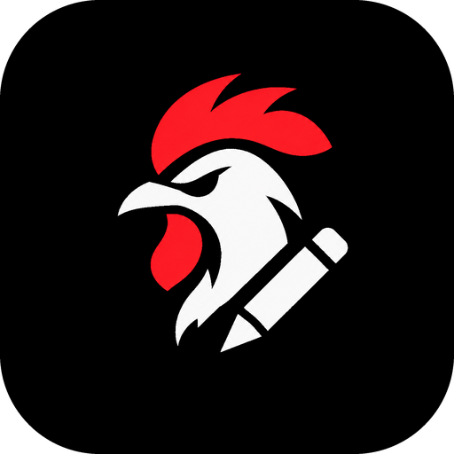
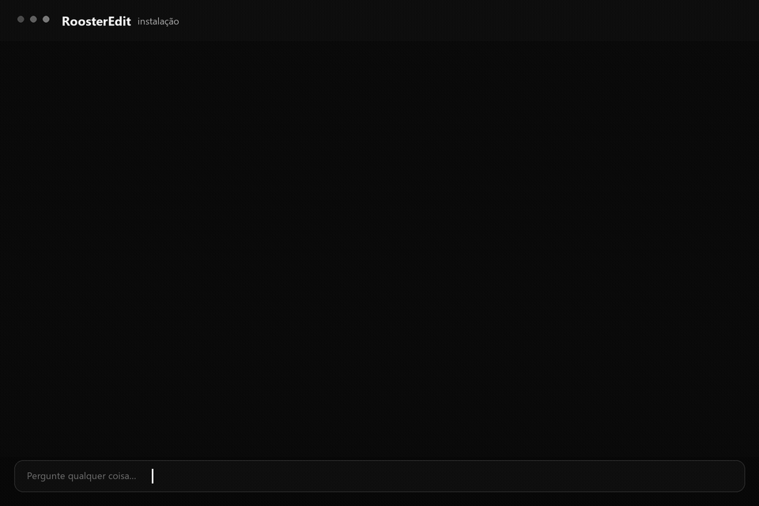

<h1 align="center">
  
  <br />
  RoosterEdit
</h1>

<p align="center">
  <strong>Um estúdio de vídeo para agentes de IA.</strong><br />
  Você traz a ideia e o material. O agente cuida do plano, da edição e do render.
</p>

<p align="center">
  
  <a href="https://nodejs.org"></a>
  <a href="#motores"></a>
  <a href="LICENSE"></a>
</p>

<p align="center">
  <a href="#instalação">Instalação</a> ·
  <a href="#como-funciona">Como funciona</a> ·
  <a href="#primeiro-vídeo">Primeiro vídeo</a> ·
  <a href="#motores">Motores</a> ·
  <a href="#documentação">Documentação</a>
</p>

RoosterEdit é uma skill que ensina agentes de IA a trabalhar com vídeo. Ela junta transcrição, plano de edição, cortes e render em um fluxo só, do material bruto ao arquivo final.

Com o RoosterEdit você edita gravações, cria vídeos narrados com imagens e gráficos, monta cenas em 3D e produz conteúdo para redes sociais. Você escolhe o formato, o estilo e a ferramenta de render, HyperFrames ou Remotion. O agente cuida do projeto do começo ao fim.

<p align="center">
  
</p>

## O que já funciona

- Organizar materiais por canais, com idioma, formato, estilo, voz e política de assets.
- Transcrever com HyperFrames/Parakeet ou Whisper.
- Montar um plano com cortes, capítulos, elementos visuais, b-roll e música.
- Aprovar 3 frames de estilo e 3 elementos de amostra antes do build completo.
- Gerar o projeto em HyperFrames ou Remotion já com os cortes e a música aplicados.
- Revisar o plano e a timeline no browser com player, contexto da transcrição e QA.
- Listar todos os textos em tela e avisar sobre cortes no meio de palavras.
- Exportar EDL/FCPXML para finalizar no DaVinci Resolve ou Premiere.
- Montar uma timeline editável no FilmCraft (opcional), com clipes de elemento separados.
+- Gerar um rascunho de issue de feedback com dados sensíveis removidos quando algo falha no caminho.
- Baixar links autorizados com `yt-dlp`.
- Usar perfis prontos ou criar os seus.
- Revisar no preview e renderizar o arquivo final.

## Como funciona

1. Você configura um canal. Ele guarda o que não muda de vídeo para vídeo: idioma, formato, estilo, voz e de onde vêm os assets.
2. Coloca o material bruto no projeto.
3. O agente transcreve, entende o conteúdo e escreve o plano de edição com cortes, elementos visuais, b-roll e música.
4. Você lê o plano, ajusta o que quiser e aprova.
5. Só então o projeto é gerado, pré-visualizado e renderizado.

O plano é o ponto de controle. Ele vira um artefato revisável antes do preview e do render. Se ele estiver errado, o vídeo inteiro sai errado.

## As 8 etapas

O agente acompanha o projeto com um marcador `Etapa X/8` e só avança nos gates de aprovação. Etapas que não se aplicam são puladas com uma explicação curta.

| Etapa | O que acontece | Você aprova |
|---|---|---|
| 1. Ambiente e workspace | doctor, workspace e canal | — |
| 2. Brief e intake | objetivo, público, formato, duração (só se você declarar) e restrições | brief |
| 3. Assets e transcrição | material, probe, transcrição e mapa editorial | — |
| 4. Plano de edição | cortes, elementos, música e capítulos | plano |
| 5. Storyboard e timeline | cenas, tempos, legendas e áudio | storyboard/timeline |
| 6. Escolha do engine e build | HyperFrames, Remotion ou FilmCraft; depois o projeto | engine/timeline e sample |
| 7. Preview e QA | preview no browser, frames e checklist | preview |
| 8. Render e entrega | draft, final, thumbnail e metadata | render final |

Na etapa 6, o agente pergunta como montar: **HyperFrames** (padrão, já pronto), **Remotion** (React/3D; precisa de `npm install` com a sua permissão) ou **FilmCraft** (timeline editável; precisa conectar o MCP e reiniciar o agente). Nada é instalado nem configurado sem você autorizar.

As etapas pesadas podem rodar em subagents para economizar contexto, mas o fluxo é o mesmo sem eles: os artefatos e os gates não mudam. Antes do plano, peça 3 frames de amostra do estilo (`styleproof`); antes do build completo, peça 3 elementos de amostra (`build --sample 3`). Isso evita refazer o vídeo inteiro por causa do look.

## Instalação

A instalação é feita pelo seu agente. Ele pergunta se você quer instalar localmente no projeto (recomendado) ou globalmente, usando a pasta de skills que o seu harness lê, clona a skill, confere Node, FFmpeg e o browser, responde em poucas linhas e pergunta se você quer criar o primeiro canal.

Você não precisa rodar comandos no terminal: o agente executa e mostra o resultado. Se quiser o prompt único de instalação + dependências + workspace, use [`templates/install-prompt.pt-BR.md`](templates/install-prompt.pt-BR.md). Custos esperados estão em [`docs/COSTS.md`](docs/COSTS.md).

Copie o prompt abaixo e cole na conversa com o seu agente:

```text
Instale a skill RoosterEdit neste projeto e valide o ambiente.

1. Antes de clonar, pergunte se quero instalação local no projeto (recomendado) ou global. Use a pasta de skills que este harness já lê; exemplos de local: `.opencode/skills`, `.claude/skills`, `.agents/skills`; exemplos de global: `~/.config/opencode/skills`, `~/.claude/skills`. Não clone nada antes da minha resposta.
2. Clone https://github.com/WesleyQDev/RoosterEdit.git na pasta escolhida, com o nome rooster-edit.
3. Confirme que o arquivo SKILL.md está no lugar.
4. Rode o doctor da skill e me mostre só o essencial: o que está pronto e o que falta, em no máximo 6 linhas.
5. Se faltar Node.js, FFmpeg ou FFprobe, me peça permissão antes de instalar qualquer coisa e explique o comando.
6. Não crie workspace, projeto ou vídeo ainda. Só instale a skill e valide o ambiente.
7. No fim, responda em no máximo 8 linhas: status da instalação, o que já está pronto, o que falta (se algo) e onde ler os detalhes. Não escreva um guia longo nem liste todos os comandos.
8. Termine com uma pergunta simples: "Quer criar o primeiro canal agora? Pensa nele como a pasta daquele projeto: dentro dela ficam os vídeos, o estilo e os arquivos da marca ou cliente. Se sim, me diga o nome do canal e o que ele vai produzir?" Se eu disser não, pare sem criar nada.
9. Se eu disser sim, use o nome que eu der (ou proponha um), infira os padrões e me mostre um resumo para ajustar. Não faça as 12 perguntas de uma vez e não defina duração.
10. Depois do canal, pergunte paleta, tipografia e motion/áudio e crie a identidade com `channel design <id>`. Se eu não tiver preferência, mantenha o perfil base.
```

Se preferir o caminho manual, o passo a passo completo está em [`docs/INSTALL.md`](docs/INSTALL.md).

## Primeiro vídeo

Peça ao agente algo como "quero fazer um vídeo sobre tal assunto". Ele cria o workspace, configura o canal, transcreve o material e monta o plano. Se você for fornecer os vídeos, ele cria e abre a pasta `assets/source/` para você colocar os arquivos. Só declare uma duração se você tiver um alvo explícito, por exemplo "quero exatamente 60 segundos".

Você revisa, aprova e ele segue para o preview e o render. Comece com autonomia `guided` nos primeiros vídeos: o agente mostra o style proof, o plano e o preview antes de seguir. Quando o estilo estiver estável, mude o canal para `auto`. O passo a passo está em [`docs/FIRST-RUN.md`](docs/FIRST-RUN.md).

## Motores

O HyperFrames é melhor para HTML, CSS, GSAP, motion graphics e vídeos para redes sociais. O Remotion é melhor quando o projeto pede React, componentes e 3D.

O FFmpeg não é um terceiro motor. Ele trabalha por baixo, nos cortes, nas legendas e na montagem.

O FilmCraft é opcional e também não é um terceiro motor criativo: ele é um alvo de timeline. Com `build --target filmcraft`, o FFmpeg monta o corte e o áudio, HyperFrames ou Remotion renderizam cada elemento com alpha, e o FilmCraft recebe um `.fcproj` editável. Sem o FilmCraft instalado, o fluxo continua em HyperFrames ou Remotion.

## Canais e perfis

Um canal guarda o que é estável na sua marca: o que ele produz, idioma, formato, estilo, voz e política de assets. Todo projeto nasce dentro de um canal e pode sobrescrever os padrões. A duração não é um padrão: ela é o resultado da edição, a menos que você declare um alvo.

Na prática, cada canal é uma pasta em `rooster/channels/<canal>/` com `projects/` (um por vídeo), `profiles/` (identidade visual e sonora), `assets/` e `library/`.

Perfis cuidam da identidade visual e sonora, como cores, tipografia, motion e legendas. Depois de criar um canal, use `channel design <id>` para gerar o perfil daquele canal. Existem três perfis prontos (`minimal`, `tech-neon` e `3d-cartoon`) que servem de base, e você também pode criar os seus. Não existe categoria separada: o conteúdo de cada vídeo fica no brief, no roteiro e no plano de edição.

## Assets

A skill pode trabalhar só com arquivos seus, com links autorizados, com uma biblioteca local, com conteúdo gerado por IA ou com uma mistura disso. A escolha fica no canal e pode mudar em cada projeto.

Ela não busca stock automaticamente. Links só entram com confirmação de direitos. Veja [`docs/ASSETS.md`](docs/ASSETS.md).

## Camadas profissionais

Depois do corte, a skill cobre legendas, zoom/transições, ducking e SFX, reframe para 9:16, thumbnail/metadata, cor/LUT, b-roll local, gráficos, TTS e multicâmera. O índice fica em [`references/professional-elements.md`](references/professional-elements.md); cada camada tem seu próprio arquivo em `references/features/`.

## Para gastar menos tokens

Trabalhar com vídeo gasta tokens, então a skill foi feita para ler o mínimo necessário: trechos da transcrição, o plano em formato legível e alguns frames do resultado. O maior ganho vem de rodar cada etapa pesada em um subagent e trazer para o agente principal só um handoff curto. As dicas estão em [`docs/TOKEN-OPTIMIZATION.md`](docs/TOKEN-OPTIMIZATION.md).

## Documentação

- [`docs/INSTALL.md`](docs/INSTALL.md): instalação e problemas comuns.
- [`docs/FIRST-RUN.md`](docs/FIRST-RUN.md): do zero ao primeiro vídeo.
- [`docs/ARCHITECTURE.md`](docs/ARCHITECTURE.md): como as peças se encaixam.
- [`docs/WORKSPACE.md`](docs/WORKSPACE.md): como o workspace é organizado.
- [`docs/ASSETS.md`](docs/ASSETS.md): direitos e políticas de assets.
- [`docs/TOKEN-OPTIMIZATION.md`](docs/TOKEN-OPTIMIZATION.md): como gastar menos contexto.
- [`docs/COSTS.md`](docs/COSTS.md): o que é grátis, o que é opcional e como evitar retrabalho.
- [`docs/REFERENCE-VIDEO-IMPROVEMENTS.md`](docs/REFERENCE-VIDEO-IMPROVEMENTS.md): o que o vídeo de referência ensina e o que já foi incorporado.
- [`docs/TESTING.md`](docs/TESTING.md): o que já foi testado.
- [`docs/ROADMAP.md`](docs/ROADMAP.md): próximos passos.

## Contribuindo

Encontrou um bug ou tem uma ideia? Abra uma issue. Se for mexer no código, rode a validação do projeto antes de mandar o pull request.

## Créditos

- [Como editar vídeos com IA usando o Claude Code](https://www.youtube.com/watch?v=EIj7WPiKmOE), de Marcos Lemos: inspiração para o fluxo de seis etapas, do estilo ao render.
- [Fábrica de animações 3D só com o Claude](https://www.youtube.com/watch?v=u6du22ySnC4), de diegokk: inspiração para o pipeline 3D com Three.js.
- [HyperFrames](https://github.com/heygen-com/hyperframes) e [Remotion](https://www.remotion.dev): os motores de render.

O RoosterEdit não copia o conteúdo dos vídeos. Ele resume os fluxos em uma skill própria, com estrutura e perfis adaptados.

## Licença

MIT. Veja [`LICENSE`](LICENSE).
